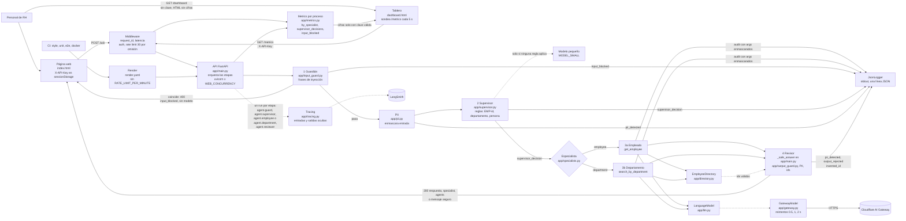

# Arquitectura del HR Assistant (sesiones 1 a 4, reto de producción y multiagente)

Asistente de Recursos Humanos que responde preguntas sobre empleados desde una página
web. API FastAPI sin estado, un modelo detrás de una interfaz y, desde la spec 06, un pipeline
de cuatro etapas por pregunta: guardián, supervisor, especialista y revisor. Las etapas se
orquestan en `app/main.py` (no hay un módulo `pipeline`). Observabilidad
(sesión 2), palancas de costo (sesión 3), acceso por clave, límite y compliance (sesión 4),
PII, validación de salida, reintentos y tablero (reto de producción). Decisiones en `adr/`
(0016 tablero, 0017 pipeline multiagente, 0018 guardián).

## Módulos del reto de producción

| Módulo | Responsabilidad |
| --- | --- |
| `app/pii.py` | Detecta y enmascara PII; devuelve texto y conteos por tipo |
| `app/output_guard.py` | Valida la respuesta: vacía, larga, PII, clave e id `EMP-xxxx` inventado |
| `app/gateway.py` (ampliado) | Reintentos ante timeout y 5xx con espera inyectada |
| `app/metrics.py` (ampliado) | Métricas de negocio, rutas, caché y PII por tipo |
| `app/static/dashboard.html` | Página pública sin cifras ni clave; lee `/metrics` con `X-API-Key` |

## Módulos del multiagente

| Módulo | Responsabilidad |
| --- | --- |
| `app/input_guard.py` | Guardián: frases de inyección, sin acentos ni mayúsculas (`blocked_phrase`) |
| `app/supervisor.py` | Elige especialista con reglas; modelo pequeño solo si no hay regla |
| `app/specialists.py` | Prompt y herramienta única de `employee` y `department` (`build_specialist`) |
| `app/output_guard.py` | Base del revisor: motivos `empty`, `too_long`, `pii`, `secret` e `invented_id` |
| `app/main.py` | Orquesta las etapas en `/ask`: `_block_injection` (guardián), `_mask_request`, `_run_agent` (supervisor y especialista), `_safe_answer` (revisor); arma `agents` y abre un run por etapa |

## Límites conocidos

- Con varios workers, `/metrics`, el límite de peticiones y la caché son por proceso.
  Cada petición ve las cifras de un solo worker (README).
- El `request_id` es UUID por petición, distinto entre procesos.
- `GET /dashboard` es público pero no contiene datos: las cifras solo salen de `/metrics`, que exige clave.
- El guardián es una lista de frases: no detiene sinónimos ni otros idiomas.
