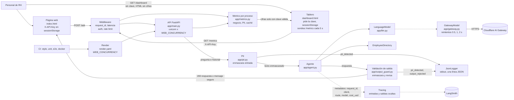

# Arquitectura del HR Assistant (sesiones 1 a 4 y reto de producción)

Asistente de Recursos Humanos que responde preguntas sobre empleados desde una página
web. API FastAPI sin estado, un solo agente con bucle con tope y un modelo detrás de una
interfaz. Observabilidad (sesión 2), palancas de costo (sesión 3) y acceso por clave,
límite de peticiones y compliance (sesión 4). El reto de producción agrega PII
enmascarada, validación de salida, reintentos, varios workers, tablero y métricas de
negocio. Decisiones en `adr/` (0013 a 0015 nuevas; 0016 del tablero queda pendiente).

## Módulos nuevos del reto

| Módulo | Responsabilidad |
| --- | --- |
| `app/pii.py` | Detecta y enmascara PII; devuelve texto y conteos por tipo |
| `app/output_guard.py` | Valida la respuesta: vacía, larga, PII, clave |
| `app/gateway.py` (ampliado) | Reintentos ante timeout y 5xx con espera inyectada |
| `app/metrics.py` (ampliado) | Métricas de negocio, rutas, caché y PII por tipo |
| `app/static/dashboard.html` | Página pública sin cifras ni clave; pide la clave, la guarda en `sessionStorage` y lee `/metrics` con `X-API-Key` |

## Límites conocidos

- Con varios workers, `/metrics`, el límite de peticiones y la caché son por proceso.
  Cada petición ve las cifras de un solo worker (README).
- El `request_id` es UUID por petición, distinto entre procesos.
- `GET /dashboard` es público pero no contiene datos: las cifras solo salen de `/metrics`, que exige clave.
