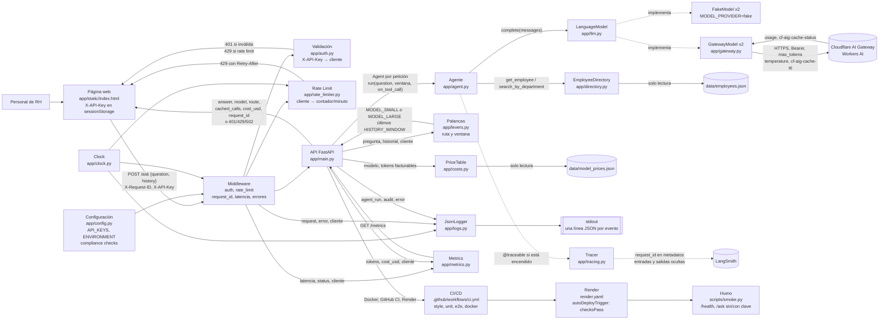

# Arquitectura del HR Assistant (sesiones 1 a 4)

Asistente de Recursos Humanos que responde preguntas sobre empleados desde una página
web. API FastAPI sin estado, un solo agente con bucle con tope y un modelo detrás de
una interfaz. La sesión 2 agrega observabilidad (id por petición, log JSON, métricas y
trazas opcionales). La sesión 3 agrega el modelo real por Cloudflare AI Gateway y
cuatro palancas de costo: enrutamiento, ventana de historial, tope de salida y caché,
con el costo de cada respuesta. La sesión 4 cierra con autenticación por API Key,
límite de peticiones y compliance como código, empaquetado en contenedor y publicado
en Render. Decisiones en `adr/`.

## Estado por sesión

| Sesión | Piezas | Estado |
| --- | --- | --- |
| 1 | `config`, `directory`, `llm`, `agent`, `main`, `static/index.html` | Implementada |
| 2 | `clock`, `logs`, `metrics`, `tracing`; middleware, `/metrics`, `request_id` | Implementada |
| 3 | `levers`, `costs`, `gateway`; `model`, `route`, `cached_calls`, `cost_usd`; `e2e/` | Implementada |
| 4 | `auth`, `rate_limiter`; `API_KEYS`, `ENVIRONMENT`, compliance; Dockerfile, CI, Render, `smoke.py` | Por implementar |

## Módulos

| Módulo | Responsabilidad |
| --- | --- |
| `app/config.py` | Lee y valida variables de entorno; compliance al arrancar si `ENVIRONMENT=production` |
| `app/auth.py` | Valida `X-API-Key`, extrae cliente, rechaza con `401` |
| `app/rate_limiter.py` | Límite por cliente por minuto; reloj inyectado; rechaza con `429` |
| `app/clock.py` | Única fuente de hora (UTC) y tiempo monótono; se inyecta |
| `app/logs.py` | Escribe un evento por línea JSON en stdout; anota `client` (nombre), nunca clave |
| `app/metrics.py` | Peticiones, tasa de error, p50/p95, tokens, costo y SLO; por cliente |
| `app/tracing.py` | Trazas de LangSmith opcionales; apagadas sin clave |
| `app/directory.py` | Consulta de empleados de solo lectura |
| `app/llm.py` | Interfaz `complete(messages)`, modelo simulado con nombre y `build_models` |
| `app/gateway.py` | Modelo real por AI Gateway con cliente HTTP inyectado |
| `app/levers.py` | Enrutamiento por regla y ventana de historial |
| `app/costs.py` | Tabla de precios y costo por respuesta |
| `app/agent.py` | Bucle con tope, herramientas, tokens, llamadas cacheadas |
| `app/main.py` | `create_app()`, middleware, `/ask`, `/health`, `/metrics`; auth y rate limit |
| `app/static/index.html` | Página única; campo de clave, `sessionStorage`; muestra `request_id`, modelo, costo |
| `Dockerfile` | Imagen `python:3.12-slim`, usuario no root, `uvicorn` |
| `.github/workflows/ci.yml` | Pipeline con 4 jobs: `style`, `unit`, `e2e`, `docker` |
| `render.yaml` | Blueprint para Render; variables, secretos, `autoDeployTrigger: checksPass` |
| `scripts/smoke.py` | Prueba de humo: `/health`, `/ask` sin/con clave |
| `doc/compliance-checklist.md` | Tabla con 8 reglas: dónde en código y cómo se comprueba |

## API

| Método y ruta | Autenticación | Qué hace |
| --- | --- | --- |
| `GET /` | No | La página web |
| `GET /health` | No | `{"status": "ok", "pid"}` |
| `POST /ask` | `X-API-Key` | Respuesta del agente, `request_id`, `model`, `route`, `cached_calls`, `cost_usd` |
| `GET /metrics` | `X-API-Key` | Métricas del proceso, costo acumulado, cumplimiento del SLO de p95 |
| `GET /docs` | No | Documentación interactiva de OpenAPI |

Toda respuesta lleva `X-Request-ID`. Un error de autenticación responde `401` con
`{"detail": "invalid or missing API key"}`; rate limit excedido, `429` con
`{"detail": "rate limit exceeded", "Retry-After": <segundos>}`; error interno, `500` con
`{"detail": "internal error", "request_id"}`; modelo no disponible, `502` con
`{"detail": "model unavailable", "request_id"}`.

## Principios

- Sin estado de conversación en el servidor (ADR 0001): el historial vive en el
  navegador.
- El agente no conoce al proveedor del modelo (ADR 0002 y 0008).
- Toda pregunta termina en a lo más `AGENT_MAX_STEPS` llamadas al modelo (ADR 0003).
- Toda petición se puede rastrear por su `request_id` sin guardar datos personales en
  el log (ADR 0004).
- Las métricas son por proceso y en memoria acotada (ADR 0005).
- Las trazas externas son opcionales, apagadas y ocultas por omisión (ADR 0006).
- El modelo se elige por regla, no por otro modelo (ADR 0007).
- Todo lo de Cloudflare (token, URL de gateway) se guarda en el servidor y nunca sale salvo
  hacia el gateway (ADR 0008).
- Toda respuesta dice cuánto costó; una palanca solo se usa si baja el costo sin bajar
  la calidad (ADR 0009).
- Cada cliente se autentica con una clave única, de mínimo 16 caracteres; la clave nunca
  se escribe en logs ni trazas (ADR 0010).
- Cada cliente tiene un límite de peticiones por minuto; se rechaza con `429` si se excede
  (ADR 0011).
- En producción se validan reglas de seguridad y privacidad al arrancar; si no se cumplen,
  no arranca (ADR 0012).
